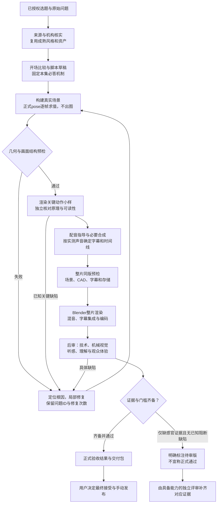

# 视频制作流程与评审现状报告

观察时间：2026年11月9日，Asia/Shanghai。对象：当前“君哥拆机器”的机械原理、拆解与连续三维动画；制作项目为 `/Users/lmj/yuntan/esp32/mechanical-video`，运营与本地发布准备在 `xiaohongshu-workflow`。

**结论：目前是一条由 Director 组织、脚本执行 CAD/Blender/声音/编码、独立角色承担内容判断的制作链。已经具备实际制作及多层门禁，但还不是能够自主完成全部观看、听审和内容验收的全自动系统。** 新规则、新检查代码和本集实际完成的评审必须分开看；不能因为流程图完整，就说每条视频都完整执行过。

本报告核对了当前规范、检查实现、单集导演记录和最新卷尺交付清单；重新验证了卷尺 V7 文件的 SHA-256 与 ffprobe。没有在本次报告编写中重新生成影片、调用配音或执行完整视听审片。

**一、从选题到交付，现在怎样推进**

图中“返回修复”表示返回缺陷所属阶段：声音问题不重建 CAD，局部镜头问题不默认重配全部旁白。修复影响邻段和最终混音时，复查相应范围。缺证据不是已知失败的降级标签；已知严重缺陷不能用“待审版”绕过。

| 步骤 | 实际怎么制作 | 本阶段检查什么、产生什么 |
| --- | --- | --- |
| 选题及范围 | 从已确认计划读取本集原题；Director 提取既有授权、锁定音画和未解决问题 | 固定“观众看完必须能回答什么”；候选题、日期计划不等于已经授权生成 |
| 来源与复用 | 查具体型号、专利/手册/源 CAD、装配映射及连接关系；打开成熟场景与参考片 | 明确事实、推断和教学示意边界；沿用舞台、材质、灯光、运动语言、字幕与声音工具 |
| 表达与草稿 | 新集比较至少三个真实可行开场；写问题—动作—接触—结果的叙述 | 固定原题、必答机制、可见答案与段落新增信息；不能为了容易制作换掉原题 |
| 出图前求值 | 在 Blender 内构建实际场景，执行正式制作同一个 `pose(frame)`，暂不渲染像素 | 新预检检查规定窗口每个整数帧的构图、尺寸、几何遮挡、连接锚点与实际运动；CAD 另查实体与源对应 |
| 最小关键小样 | 只先渲染决定原理是否成立的动作段；必要时比较局部 A/B | 对照实际源件，核对输入如何传到接触点并改变输出；关键动作不清就先修，不铺成整片 |
| 配音与定时 | 核心画面可实现后，指导重音/自然表达，按授权配置合成必要句段 | 实测声音时长；再更新字幕、镜头与动作时间。已批准旁白保持锁定，视觉修订不默认重配 |
| 整片制作 | Visual 完成场景/动画/相机；Editor 集成帧、拟音、混音、字幕和编码 | 同版全片放行、字幕标注避让、磁盘余量；重型制作串行，保持任务锁与归档 |
| 成片后审 | 对最终 MP4 做技术检测，并由实际具备能力的独立评审观看、听审 | 检查机械/视觉、连续性、声音、字幕、节奏、理解、情绪与结尾；记录精确时间码 |
| 交付与复盘 | Director 汇总同版本证据，准备本地平台包装，用户手动发布 | 分开记录制作完成、用户接受、独立验收、实际发布；发布后按平台与窗口观察真实表现 |

早期静音小样不必等待最终配音。完整正式评分也不应成为所有可逆准备工作的前置条件；但相关已知 P0/P1、关键机械不确定性和明确 hold 会阻断依赖制作。

**二、谁负责制作，谁负责评审**

| 职责 | 负责的工作 | 不可替代的边界 |
| --- | --- | --- |
| Director（主线程） | 范围、阶段、依赖、证据、唯一责任人、版本和缺陷闭环 | 不代独立评审填分，也不把用户当第一轮找错的人 |
| Research | 源事实、实例映射、连接/运动依据和推断边界 | 查到资料不等于画面已正确实现 |
| Creative Director / Script | 开场、信息推进、原理表达、旁白与字幕文字 | 不以创意覆盖事实，不静默修改已批准音频 |
| Visual | CAD/场景/动画/相机、局部小样和冻结渲染源 | 自检不能充当自己的独立 QA |
| Audio Director / Audio | 表达指导、授权配音、版本保存与测时 | 不以 TTS 日志证明自然好听 |
| Editor | 最终时间线、拟音、混音、字幕集成和编码 | 不靠剪辑掩盖源机构错误 |
| 独立音频技术 / 听感 QA | 实际语音与最终混音的准确性、同步、清晰和自然度 | 原始旁白报告不能代替最终混音审核 |
| Video QA / Audience QA | 实际影片的机械视觉与整体观众体验 | 抽帧、解码与高分标签不能代替完整观看、听审和理解 |

这些是职责，不是每条视频必须同时启动一整套代理。需要真实独立身份和实际工具能力；配置了角色或换了模型，并不意味着已经完成独立评审。当前未验证可用的自动连续视听接口，这是全链路的主要缺口之一。

**三、渲染前、渲染后各自评审什么**

| 层次 | 必须回答的问题 | 能证明的范围 |
| --- | --- | --- |
| 原题/脚本审查 | 还在回答原题吗？每个必答机制是否进入脚本、画面与结尾？ | 内容契约校验完整关联；语义是否正确仍须真实独立核对 |
| CAD 与场景结构前检 | 源件对应吗？形状/连接/运动是否有依据？外部输入是否能够作用于内部？ | CAD 有限采样和实体检查；不能把正体积当成机构功能完整 |
| 出图前画面前检 | 规定帧中关键部件是否在框内、足够大、指定表面可见、连接未断、动作实际发生？ | 实际求值后的几何结果；不证明材质、光照、景深、运动模糊或观众看懂 |
| 小样审查 | 不听制作方解释，能否看出谁动了、碰到哪里、为何改变结果？ | 实际被看过的局部区间；局部认可不代表整片通过 |
| 最终技术后审 | 编码/分辨率/帧率、全片解码、黑场/静止/静音候选、字幕与版本关联是否正常？ | 检测事实及候选异常；静止可能是有效停留，须结合上下文 |
| 最终机械视觉与音频后审 | 接触、方向、连续动作、旁白/字幕/声音是否对应？有没有误读、遮挡、断裂和不自然？ | 必须绑定最终文件及实际观看/听审覆盖；缺证据不能补分 |
| 最终观众后审 | 开头为何值得看？中段有没有新信息？能否复述？情绪是否推进？结尾是否兑现？ | 内容与体验判断，不是平台效果保证 |

渲染前检查不能取消后审。后审发现的问题，能转成确定性条件的应补进前检；表达性问题应补进小样任务及独立评审问题。不能只在成片末尾增加一张评分表。

**四、点赞、收藏、关注与情绪，怎样评判**

机械视频的情绪不必是煽情，可以是“熟悉—疑惑—意外—看懂—满足”。评审要记录实际画面和时间码，不从文案描述推断观众已经产生情绪。

| 维度 | 实际检查问题 | 什么不能当证据 |
| --- | --- | --- |
| 继续观看 | 问题是否可辨认？第一段答案出现前是否持续新增信息？ | 镜头一直移动、模型很精细不等于有推进 |
| 点赞潜力 | 有没有明确的理解收获、惊讶、审美满足或认同点？发生在哪里？ | 写了“原来如此”不等于产生了惊喜 |
| 收藏潜力 | 有没有值得回看的路径、对照或知识？首次观看是否也能理解？ | 收藏数不能自动解释成“内容有用”，也可能是没看懂或想以后看 |
| 关注潜力 | 本集是否兑现承诺？后续是否还有不同的新问题和稳定价值？ | 求关注口播不等于持续关注理由；不能故意扣住本集答案 |
| 情绪和共鸣 | 是否从熟悉动作建立兴趣，再通过因果变化获得理解与满足？有没有平、乱或拖的段落？ | 音量、语速或情绪分数不能单独证明共鸣 |
| 结尾 | 能否用一句话复述本题答案，且实际画面已经证明？ | 重复总结与拆装不能代替关键因果 |

每集选主要目标，不要求机械地凑齐所有互动点。上述都是需要检验的内容假设。实际增长须回到同平台、同版本、明确发布时间/观察时间/指标窗口的数据；不能由单条指标断言观众心理或算法原因。

**五、什么情况下通过，什么情况下返工**

- 严重缺陷、原题没回答、关键因果缺失或看不清、关键机械事实未确立：阻断相关后续制作，定位根因，先验证最小修复。
- 每个缺陷保留稳定 ID、版本、时间码、证据、唯一责任人和累计修复次数。上一版本的问题不能通过换目录、换名字或移到历史字段消失。
- 同一问题最多三轮自动修复；同一策略两轮没有可观察改善就停下诊断。达到上限不能无限重渲，必要决策集中汇报，不让用户不断猜修改方向。
- 缺感官证据：标 `NEEDS_REVIEW`，对应分数保持空值。已知失败标 `REWORK/FAIL`，不能降成“只是没评”。
- 正式验收保留现有门槛：总体及技术要求≥90、观众体验≥85、音频技术≥90、音频听感≥85；还须满足既有分项最低值、同版证据、独立身份、无未关闭严重缺陷及全部规定门禁。高总分不能覆盖原理没讲清。

数字是有证据的评审结果的门槛，不是自动扫描会可靠算出的内容质量。当前完整感官评分仍未自动实现。

**六、最后的视频应当是什么样**

观众看到的应是一条熟悉物品的机械原理片：先看懂完整物品在做什么、遇到什么问题；随后在同一空间里连续展开，始终能辨认零件来自哪里；镜头跟随真正的输入、传动与接触，把关键变化看清；最后回到完整动作，用实际结果回答开头。

- 风格：复用已认可的教学舞台、材质、灯光与连续相机语言，克制标注，不用瞬移、忽隐忽现或无根据的几何变化蒙混机构关系。
- 解释：一个可复述的核心答案；关键接触、状态变化与完整动作周期优先。推断尺寸、教学分离、柔性体示意必须与真实事实区分，不声称动力学或制造认证。
- 节奏：时长由完整解释决定，**新片没有统一90秒下限**。先删重复介绍、重复拆装与空转，不通过拉慢语音、循环动作凑时长。必要慢动作应揭示新信息。
- 声音：自然旁白，轻而同步的机械拟音，避免每次变化叠冲击音；合成拟音不冒充原机实录。保持本集已批准的模型与音色；当前打印机默认 `qwen3-tts-flash / Kai`，其他未配置任务默认 Ethan，本集已有覆盖时优先沿用覆盖。
- 规格：当前机械竖屏交付基线为1080×1920、30fps、H.264视频/AAC音频；旁白字幕单行，每条最多20字符，一次一条，避免压住关键接触与标签。实际原生/编码规格分别记录，不靠放大编码冒充原生质量。

以卷尺为例，应完整看见“拉出—锁住—释放回卷”，解释卷簧提供回卷、制动件提供止动，以及外部按钮如何通过真实连接控制它。尺头厚度补偿属于另一问题，不能替换这一原题。

这段描述是交付标准，不是对现有片观感的冒充评价；本次没有完整观看、听审现有成片。

**七、最终交付不只有一个 MP4**

| 交付内容 | 用户能明确知道什么 |
| --- | --- |
| 最终 MP4、版本、时长、SHA-256 | 当前看的是哪一版，认可是否绑定到这一确切文件 |
| 一页交付说明 | 本集回答什么、改过什么、实际验过什么、哪些尚未完成 |
| 技术及独立评审报告 | 结果、方法、覆盖、时间码、缺陷和同版证据，而不是孤立“PASS” |
| 可继续制作的源与归档 | CAD/场景/渲染源、字幕与时间线、声音及来源；已有批准资产可恢复 |
| 原题契约与问题清单 | 是否遗漏必答点、哪些旧问题仍存在，修复次数有没有保留 |
| 双平台本地发布包（进入包装任务时） | 共用已验收视频，分别准备标题、封面、正文和发布清单；准备不等于上传或发布 |

正式通过、用户接受和实际发布分开记录。用户最终决定接受与发布；用户不应替代制作流程做第一轮全面找错。

**八、截至观察时间，真正完成到哪里**

| 项目 | 当前核实状态 | 不能扩大为 |
| --- | --- | --- |
| 题意契约与关键动作门禁 | 已有代码和回归测试；配音前检查草稿/必答机制/局部证据关联，交付再关联终片区间 | 机器已自动理解原题和影片 |
| 受控制作命令 | 已实现 v4 检查与 argv/证据绑定，阻断时不启动命令 | 所有系统进程和归档脚本都已不可绕过 |
| 无出图逐帧场景预检 | 代码和8项单元/集成测试已有；全片门禁已要求同版报告 | 已在当前生产片完整运行过，或真实 Blender 六例回归已通过 |
| Blender 六例无出图回归 | 首次尝试被当时占用的 render.lock 挡住；当前结果文件仍不存在 | 本次锁当前仍占用，或本次报告已补跑完成 |
| 连续视听评审 | 本地播放包、证据契约、导入与防伪标签门禁已实现 | 自动连续观看/听审接口已接通，或代理已经理解完整影片 |
| 棘轮 EP01 | 导演记录为技术通过、感官仍待审；扩展 Kai 待审片约36.87秒 | 全部独立正式验收通过 |
| 按动笔 EP02 | V7角度修订交付记录约86.9秒，仍缺实时/听审/独立观众证据；旧关键清晰度问题记录未正式关闭 | 因为出了新版就已讲清 |
| 卷尺 EP03 | 最新记录已更新到内部原理修复 V7，91.433333秒，2743帧，1080×1920@30，H.264/AAC；文件hash实测匹配 | V6仍是最新，或V7已独立正式验收 |

卷尺V7交付清单记录保留原旁白、混音、时间线与字幕，并修正外部控制、尺钩连接及连接标记。清单同时明确：自动模块由生产者运行，**不是独立感官验收**；仍需独立实时机械/音画/观众评估、最终混音自然听审、逐词/动作/字幕对齐。0—2秒、16.67—20.67秒、50—52.5秒、84.8—88.3秒的静止扫描候选仍需结合实际意图判断，不能直接认定为故障。

当前[V7实际视频](/Users/lmj/yuntan/esp32/mechanical-video/series/everyday-mechanisms/episodes/EVERYDAY_EP03/internal-repair-v7/Tape-measure-internal-principle-v7-repaired-review.mp4)与[交付记录](/Users/lmj/yuntan/esp32/mechanical-video/series/everyday-mechanisms/episodes/EVERYDAY_EP03/internal-repair-v7/delivery-manifest.json)可以查看。视频 SHA-256：`3f542ad8dfaa83ff325bb9f7a10d724fadf72b98d44e9eb4cb15f7b58e8793cc`。

**九、目前仍需完成的闭环**

1. 在既有锁释放且授权执行条件满足时，实际运行无出图 Blender 六例回归，诊断结果；再在独占新制作版本接入同一 pose 前检。不得倒填为当前 V7 已执行。
2. 接通并验证能真实连续观看、听审的独立评审能力。现阶段只能由具备能力的独立评审者完成感官分支；责任由 Director 安排，不能默认交给用户找错。
3. 每次新任务实际使用受控入口，保存同版证据；现有入口是协作约束，直接调用旧脚本仍存在绕行路径，不是操作系统级控制器。
4. 逐步统一历史规范：旧批准风格和增长文档仍有“至少90秒”措辞，当前按11月9日用户决定及AGENTS的新片无统一下限执行。历史批准、旧报告不回写；执行者应读取当前覆盖规则，不能沿旧片长指标凑时长。
5. 用实际执行数据检查改进：用户发现的缺陷、重大返工、局部/全片重渲次数、首次交付耗时和验收完整度。检查代码通过测试不等于生产成功率已提高。

**十、核查入口与证据**

- [制作总约束](/Users/lmj/yuntan/esp32/mechanical-video/AGENTS.md)、[角色与阶段工作流](/Users/lmj/yuntan/esp32/mechanical-video/.codex/agent-workflow.md)。
- [制作放行](/Users/lmj/yuntan/esp32/mechanical-video/docs/production-preflight.md)、[原题与返工预防](/Users/lmj/yuntan/esp32/mechanical-video/docs/production-rework-prevention.md)。
- [渲染前实际场景检查](/Users/lmj/yuntan/esp32/mechanical-video/docs/pre-render-scene-checks.md)、[连续视听评审](/Users/lmj/yuntan/esp32/mechanical-video/docs/perceptual-review.md)。
- [视频QA](/Users/lmj/yuntan/esp32/mechanical-video/docs/video-qa.md)、[音频QA](/Users/lmj/yuntan/esp32/mechanical-video/docs/audio-qa.md)、[观众QA](/Users/lmj/yuntan/esp32/mechanical-video/docs/audience-qa.md)。
- [本次读取的源指纹与现场检查](/Users/lmj/yuntan/esp32/xiaohongshu-workflow/07_运营/evidence/production-workflow-report-20261109/source-snapshot.json)。

以上为观察时点快照；源规范与其他制作会话之后可能继续更新。程序测试数量引用现有 validation 记录，本次文档任务没有重复运行制作测试或补做感官评分。
